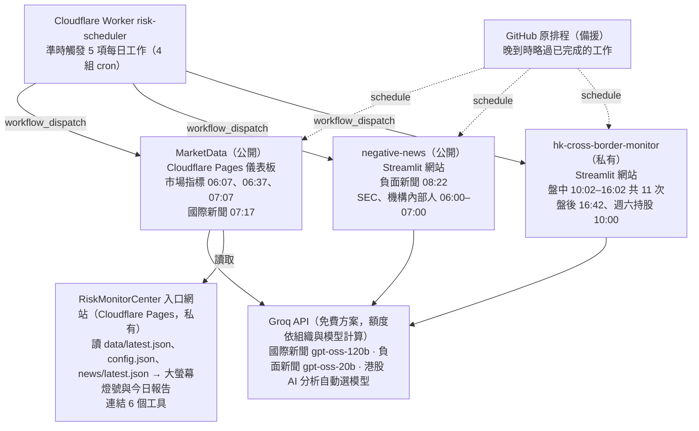

# 風險管理中心系統架構總覽

> 最後同步：2026-10-28。本檔與 Claude 文件「風險管理中心系統架構總覽」內容一致；修改任一份時，另一份也要同步更新。

入口網站串接 7 個 repo，其中 3 個有自動排程，由 Cloudflare Worker `risk-scheduler` 準時觸發、GitHub 原排程備援。入口只讀 MarketData；最緊的限制是 Groq 免費額度，最需要追蹤的是排程器 token 的到期日。

## 系統關聯圖

入口網站只讀 MarketData 的資料檔，不寫入任何 repo；台股跨境監控、ESG 指南、香港 KYC 表單沒有排程，入口網站只是開啟連結。

## Repo 一覽

入口網站連到 6 個工具，背後是 7 個 repo；只有 MarketData、negative-news、hk-cross-border-monitor 三個有自動排程。

| Repo | 角色 | 所屬領域 | 網站與存放位置 | 公開／私有 | 排程 |
| --- | --- | --- | --- | --- | --- |
| [RiskMonitorCenter](https://github.com/RMSecfb/RiskMonitorCenter) | 3D 入口網站；`scheduler/` 是排程器 Worker 的原始碼 | 入口 | [Cloudflare Pages](https://riskmonitorcenter.pages.dev/) | 私有 | 無（只讀資料） |
| [MarketData](https://github.com/RMSecfb/MarketData) | 市場指標、門檻設定、國際新聞摘要；入口大螢幕燈號的唯一資料來源 | 市場及信用風險 | [Cloudflare Pages 儀表板](https://marketdata-dga.pages.dev/)＋GitHub Actions | 公開 | 有 |
| [negative-news](https://github.com/RMSecfb/negative-news) | 負面新聞判讀、SEC Form 4／13F、機構與內部人、離線覆核匯入 | 市場及信用風險 | [Streamlit](https://negative-news-nb2mx3cwjfzt67getqpmts.streamlit.app/)＋GitHub Actions | 公開 | 有 |
| [hk-cross-border-monitor](https://github.com/RMSecfb/hk-cross-border-monitor) | 港股跨境交易盤中與盤後監控 | 經紀業務 | [Streamlit](https://hk-cross-border-monitor.streamlit.app/)＋GitHub Actions | 私有 | 有 |
| [cross-border-trading](https://github.com/RMSecfb/cross-border-trading) | 台股跨境交易監控；資料是上傳的 CMoney Excel | 經紀業務 | [Streamlit](https://risk-monitor-cross-border-trading.streamlit.app/) | 私有 | 無 |
| ESG 永續綠色金融綜合指南 | 靜態手冊 | ESG 永續 | [Cloudflare Pages](https://fubonsecurities.pages.dev/) | 未檢查 | 無 |
| HK-Margin-KYC | 香港 RPQ／KYC 表單 | 作業風險 | [GitHub Pages](https://rmsecfb.github.io/HK-Margin-KYC/) | 未檢查 | 無 |

工具清單登錄在 RiskMonitorCenter 的 `config/modules.json`；新增工具只要加一筆，不必改程式。

## 排程時間表

五項每日工作由 Cloudflare Worker `risk-scheduler` 準時觸發，GitHub 原排程保留作備援；其餘四項只靠 GitHub 排程，可能延誤 1–2 小時。時間皆為台北時間，cron 為 UTC。

| 台北時間 | 工作 | Repo 與 workflow | Cloudflare cron | GitHub cron（備援） | 重複觸發時 |
| --- | --- | --- | --- | --- | --- |
| 週二至週六 06:00 | SEC Form 4 每日擷取 | negative-news `sec-form4-daily.yml` | 無 | `0 22 * * 1-5` | — |
| 週二至週六 06:07、06:37、07:07 | 市場指標 | MarketData `fetch_market.yml` | `7,37 22 * * MON-FRI`、`7,17 23 * * *` | `7 22`、`37 22`、`7 23 * * 1-5` | 資料已齊全就略過（`respect_complete`） |
| 週二至週六 06:30 | SEC 13F 季度擷取 | negative-news `sec-13f.yml` | 無 | `30 22 * * 1-5` | 季度已發布且超過申報期 60 天就略過 |
| 每天 07:00 | 機構與內部人同步（不用 LLM） | negative-news `institutional-insider-sync.yml` | 無 | `0 23 * * *` | — |
| 每天 07:17 | 國際新聞摘要 | MarketData `world_news.yml` | `7,17 23 * * *` | `17 23 * * *` | 今日已產生就略過（`skip_if_done`） |
| 每天 08:22（約 09:15 結束） | 負面新聞判讀 | negative-news `negative-news-ai.yml` | `22 0 * * *` | `20 0 * * *`（08:20） | 以每日排程身分執行，晚到的備援略過（`as_schedule`） |
| 週一至週五 10:02、10:32、11:02、11:32、12:17、13:32、14:02、14:32、15:02、15:32、16:02 | 港股盤中監控 | hk-cross-border-monitor `intraday.yml` | `2,17,32,42 2-8 * * MON-FRI`（程式再篩時間） | 同上 11 個時間 | GitHub 排程晚到且同一時段已成功執行就略過 |
| 週一至週五 16:42 | 港股盤後批次 | hk-cross-border-monitor `eod.yml` | 同上 | `42 8 * * 1-5` | 同上 |
| 週六 10:00 | 港股持股更新 | hk-cross-border-monitor `shares.yml` | 無 | `0 2 * * 6` | — |
| 上傳時 | 離線覆核匯入 | negative-news `review-import.yml` | 無 | 推送 `review_inbox/*_已確認.xlsx` 時 | — |
| 手動 | 港股歷史回補 | hk-cross-border-monitor `backfill.yml` | 無 | 無 | — |

市場指標排在台北週二至週六，因為 UTC 週一至週五晚上對應台北隔天清晨；Cloudflare 的星期要寫英文縮寫，它的數字 1 代表週日。同一 repo 內會寫入同一份資料的工作共用 concurrency group（負面新聞、SEC、覆核匯入共用 `unified-risk-news-main`；港股共用 `hk-data`），不會同時寫入。

## Token 與金鑰

共有 4 把 GitHub token 要自己管到期日，其中排程器那把過期影響最大。GitHub Actions 內建的 `GITHUB_TOKEN` 由系統自動發放，不必管理。金鑰值只存在下列設定頁，不放進任何 repo。

| 金鑰名稱 | 存放位置 | 用途 | 權限 | 失效時的影響 |
| --- | --- | --- | --- | --- |
| `GITHUB_TOKEN` | Cloudflare Worker `risk-scheduler` → Variables and Secrets | 準時觸發 5 項每日工作 | RMSecfb fine-grained token；MarketData、negative-news、hk-cross-border-monitor 的 Actions 讀寫 | 排程改由 GitHub 備援執行，可能晚 1–2 小時 |
| `GITHUB_TOKEN` | MarketData 的 Cloudflare Pages → Secrets | 儀表板寫入 CDS、人工輸入、門檻設定 | MarketData Contents 讀寫 | 儀表板無法儲存，市場指標仍照常更新 |
| `GITHUB_TOKEN`、`GITHUB_REPO`、`GITHUB_BRANCH` | negative-news 的 Streamlit → Secrets | 網站讀取資料、儲存人工覆核 | negative-news Contents 讀寫 | 網站無法存人工覆核 |
| `GITHUB_TOKEN`、`GITHUB_REPO`、`GITHUB_BRANCH`、`ADMIN_PASSWORD` | hk-cross-border-monitor 的 Streamlit → Secrets | 讀寫資料、從網站手動觸發工作；管理功能密碼 | hk-cross-border-monitor Contents 讀寫＋Actions 讀寫 | 私有 repo 讀不到，網站無法顯示資料 |
| `GROQ_API_KEY` | MarketData 的 Actions secrets | 國際新聞摘要 | Groq API | 當日報告沒有新聞摘要，燈號不受影響 |
| `GROQ_API_KEY` | negative-news 的 Actions secrets | 負面新聞 LLM 判讀 | Groq API | 新聞排入待補分析 |
| `GROQ_API_KEY`（選用） | hk-cross-border-monitor 的 Streamlit → Secrets | 網站上按一下產生 AI 分析 | Groq API | AI 分析按鈕無法使用 |
| `FRED_KEY`（選用） | MarketData 的 Actions secrets | 讀取高收益債 OAS 等 FRED 資料 | FRED API | 自動改用 FRED 公開 CSV |
| `SEC_IDENTITY` | negative-news 的 Actions secrets | SEC EDGAR 要求的申請者身分 | 非密碼，為名稱與聯絡信箱 | Form 4／13F 略過，不算失敗 |
| `app_password` | cross-border-trading 的 Streamlit → Secrets | 網站登入密碼 | — | 無法登入 |

待確認：三個 `GROQ_API_KEY` 是否來自同一個 Groq 帳號；若是，額度會共用（見下節）。各 token 到期日請補在 `MAINTENANCE.md`。

## 資料與額度限制

最緊的是 Groq 免費額度：負面新聞每天最多約 125 次判讀，已設上限 120 次，舊的待補分析要靠離線覆核。其次是公開 repo 的資料任何人都看得到。

| 項目 | 上限或特性 | 目前用量 | 影響的工具 | 超過或失效時 |
| --- | --- | --- | --- | --- |
| Groq `openai/gpt-oss-20b` | 每天 1,000 次、200K token；每分鐘 30 次、8K token | 每次約 1,600 token；每日排程 100 次、總上限 120 次、間隔 20 秒 | negative-news | 超出的新聞標 `QUOTA_PENDING`，等新額度或離線覆核 |
| Groq `openai/gpt-oss-120b` | 同上，與 20b 分開計算 | 國際新聞每天 1 次，約 4.2K token | MarketData 國際新聞；港股 AI 分析可能改用這個 | 當日摘要標為失敗，可手動重跑 |
| Groq 港股 AI 分析 | 優先用 `llama-3.3-70b-versatile`；沒有時自動改用下一個可用模型 | 每按一次約 1,500 token | hk-cross-border-monitor | 按鈕顯示錯誤，其他功能不受影響 |
| Cloudflare Workers 免費方案 | 每個帳號 5 組定時觸發；每次執行 CPU 10 毫秒 | 已用 4 組 | 所有準時排程 | 新增排程要合併到既有組合，由 `jobsFor()` 篩時間 |
| GitHub Actions 私有 repo | 免費方案每月 2,000 分鐘；公開 repo 不限 | 港股每個交易日 12 次，Cloudflare 與 GitHub 都觸發時會跑兩次 | hk-cross-border-monitor | 當月剩餘排程停跑；建議每月初看一次用量 |
| GitHub Actions 定時排程 | 不保證準時，清晨曾晚 2.5 小時 | — | 只靠 GitHub 排程的 SEC、機構內部人、港股持股 | 資料較晚到 |
| Yahoo Finance（yfinance） | 非官方介面，可能延遲或缺值 | 延伸股市與匯市 11 項 | 大螢幕燈號 | 最新收盤空值時改讀即時收盤；台股加權改用證交所資料；06:37／07:07 遇非同日只重抓延伸指標 |
| FRED | 資料晚 1 個營業日 | 高收益債 OAS | 大螢幕債市 | 顯示前一日數值 |
| SEC EDGAR | 需申請者身分；請求頻率有上限 | Form 4 每日、13F 每季 | negative-news | 未設身分時略過 |
| CMoney 資料 | 授權資料，只在私有 repo | 資料只到 2025-12-31（上傳於 8/5） | cross-border-trading | 需人工上傳新檔才會更新 |
| raw.githubusercontent.com | 快取約數分鐘 | 入口網站讀 MarketData | RiskMonitorCenter | 剛更新時可能仍看到舊值；讀不到改用 `snapshot/` |
| Streamlit Community Cloud | 一段時間沒人用會休眠 | 3 個網站 | negative-news、兩個跨境監控 | 第一個開啟的人要等喚醒 |
| 公開 repo | 任何人都能看到程式與資料 | MarketData、negative-news | — | 不要放內部機密資料 |
| Cloudflare Access | 尚未設定 | — | RiskMonitorCenter、MarketData 儀表板 | 知道網址就能開啟入口網站 |

Groq 額度依組織計算，不是依金鑰；三個工具若用同一個 Groq 帳號，用同一模型時會互相扣額度（[Groq 額度說明](https://console.groq.com/docs/rate-limits)）。
